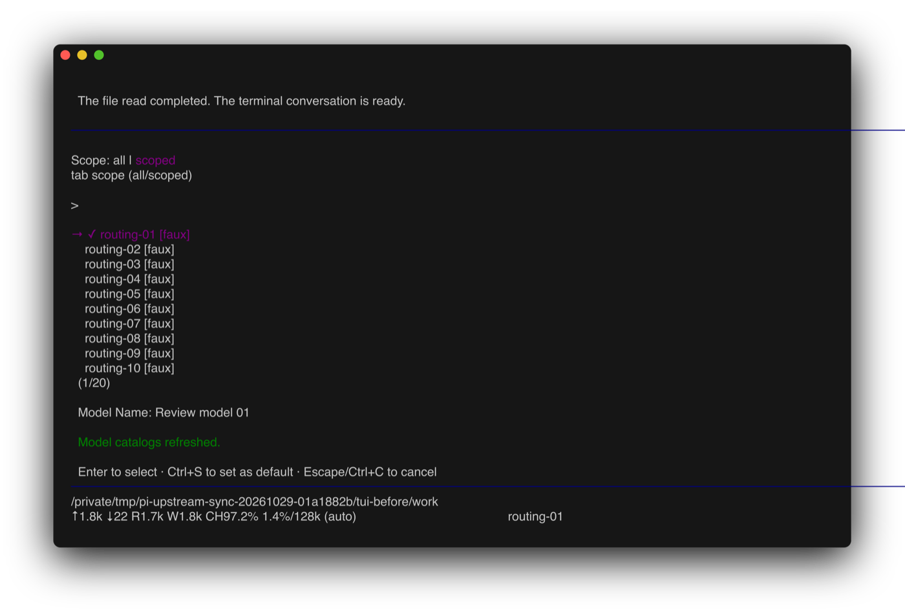
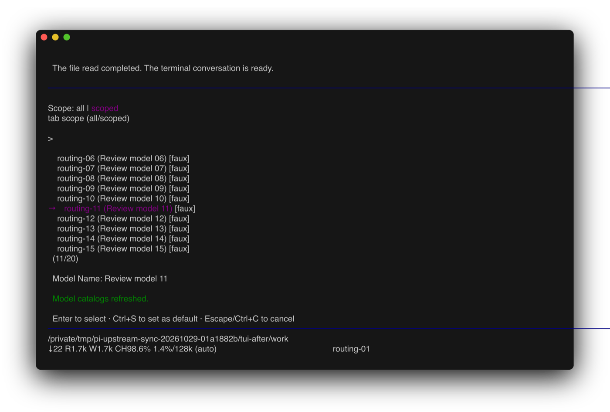

# Upstream integration, 2026-10-29

## Goal and references

Keep Mitch's fork current with upstream without losing the approved capabilities in
[FORK.md](../FORK.md). Adopt equivalent native behavior instead of preserving old mechanisms.

- Fork baseline is `581b5c1874ad2dcd42ea37d37a35a0539b6cf3b6`.
- Upstream target is `0d23d53457a6b9a660c4cbbae061ba277e0fad11`.
- The previous upstream baseline is official v1.4.0,
  `4a080252f06caf63a525d7873c5d94d3c23887e0`.
- The incoming range contains 210 commits. This is a merge, not a squash, so upstream ancestry
  remains available for the next synchronization.

## Integration decisions

| Boundary | Decision and reason |
| --- | --- |
| Catalog generation | Use upstream's `packages/ai/catalog/generate.ts` and provider definitions. Delete the old generator rather than wrap it. The AI package's existing scripts point at the native entrypoint. |
| Kimi catalog and overlays | Share the retained runtime K3 metadata with the native catalog family. K3's five-minute cache-write rate remains $3/M. A real public-catalog refresh exposed a missing `k3-256k` alias in the retained normalizer. Include that alias so the refresh cannot replace the bundled rate with zero. New K3.1 entries follow upstream. Published and cached catalog normalization remains in `src/api/kimi.ts`. |
| Cloudflare catalog and overlays | Apply the existing normalizer after native family rules. Keep canonical Claude IDs and Opus 5.5 positional controls and cache lifetimes. Track OpenAI's developer-message and dynamic-tool flags independently. GPT-5.5 and older follow upstream's replay-namespace correction; GPT-6.1 Terra gets both defaults. Explicit metadata and custom endpoints remain authoritative. |
| Tool argument streaming | Use upstream's incremental parser and per-call stream state. Final argument parsing still reaches the retained repair function. Preserve request-wide strict-tool budgets, request compression, cancellation and passive cache tracing. Record OpenRouter trace costs after native billed-cost adjustment. |
| Google adapters | Keep the shared request/stream implementation and disabled SDK continuation. Adopt native usage-cost provenance. The fork's exact usage assertion now includes `totalFromProvider: false`, because Gemini costs are estimates. |
| Support packages | Adopt native Markdown tokenization and Env watcher APIs. Preserve path hyperlinks, the Setext guard, malformed-frame and watch-overflow regressions, bounded MCP error reads and compatible released changelog sections. |
| Durable admission and persistence | Merge `admission` into native `CommitOptions`, removing the duplicate transaction-scope flag. Run admission before native deferred-state holding or consumption. It checks the current commit's own writes, not earlier held progress; actual persistence errors retain native fatal semantics. Keep per-input refusal, corrected resubmission, exact SQLite rollback and post-effect compaction behavior. Adopt native observers, tagged watch/end values and Storage's adoption callback. |
| Coding-agent | Keep accepted journal entries in memory after an append failure and rewrite on the next write, as required by #257, rather than adopt upstream's incompatible rollback. Keep private file-fork creation. Adapt compact cards to native constructor and pending-argument changes, retain saved working-state cwd priority, and guard the new extension-changelog setter during working-state capture. |
| Retired coding-agent paths | Use native npm `--no-audit --no-fund`, iterative HTML tree traversal and macOS shell cancellation. Remove the redundant fork traversal and extra Linux pause in the main shell helper. Keep the existing public behavior and regressions. |
| Telemetry exports | Retire the fork-only source-condition correction. Upstream now supplies the same root `source` export. |
| Fork delivery policy | Keep fork-local contributor approvals and authorization. Do not import upstream publishing or preview-release workflows. Keep the isolated test runner, package-consumer verification, compiled extension regression and macOS restart/background coverage while adopting native split CI jobs. |
| Dependencies | Preserve the fork's reviewed exact pins. The refreshed root lock only removes `autoevals` and its now-unused dependency graph. No new dependency version or lifecycle script is introduced. The coding-agent install lock is unchanged. |

The catalog comparison against the baseline generator found 147 changed entries. These include
native provider routing and Kimi/Claude metadata, GPT-6.1 Terra, newer chat models and the removal
of five realtime/image entries that were incorrectly offered as chat models. No Cloudflare Claude
model changes appeared in that comparison. Installed-release ID losses are reviewed separately
before selector activation.

The experimental Chord `./next` export is additive. It does not replace the current Chord
transport used by existing consumers. Coding-agent continues to use the current strict-JSON
helpers for complete working-state snapshots.

## Local verification record

The baseline passed `npm run check`, `npm run build:offline`, the Env daemon build and the full
isolated `./test.sh` suite. It also completed a real interactive terminal conversation through
Pi's faux provider, the actual `read` tool and a final response, then opened the model selector.
This uses an isolated home without credentials or paid model calls.

The candidate passed these checks on macOS arm64 with Node 24.22.1:

- `npm run generate:models` ran the package's strict generator. Public catalog hydration produced
  1,597 tool-capable chat models.
- `npm run check` passed formatting, dependency declarations and pins, relative imports, entry graphs,
  the coding-agent install lock, TypeScript, and the browser bundle check.
- `env -u BASH_ENV PATH=<PATH without coreutils gnubin> ./test.sh` passed the complete offline suite,
  including Durable's memory, SQLite, Store, and Worker configurations. Live-provider and external
  platform cases remained skipped. The PATH change follows the existing Env fixture requirement in
  [FORK.md](../FORK.md#testing). It does not change product code.
- The Env daemon build, locked Clippy check, Rust format check, and Rust unit tests passed.
- `./test.sh -- node scripts/check-package-install.mjs` verified ten isolated package consumers,
  their local dependency resolution, public exports, and the installed coding-agent CLI and SDK.
- The bundled background-command smoke verified that the shipped worker completed after CLI exit.
  The codemode background smoke verified the receipt, foreground completion, and later result delivery.
- A refresh through the actual remote-catalog provider against `https://pi.dev` preserved the
  `kimi-coding/k3-256k` cache-write rate at $3/M. The same refresh returned zero before the alias fix.
  This was a public metadata request, not a paid inference call.
- Real 100-by-30 tmux sessions completed a conversation through Pi's faux provider and actual `read`
  tool in normal, compact, and hybrid modes. PageDown moved the native model selector from item 1
  to item 11. Replacing the editor while a permission dialog was open kept the dialog visible and
  preserved its draft after dismissal. All sessions used isolated homes and exited cleanly.

The integration also aligned retained fixtures with native behavior. Google usage now includes
`totalFromProvider: false`. Anthropic's top-level effort stays `low`, while the per-message markers
retain the selected effort. The prompt-widget exec fixture supplies the required `truncated` field.
The Chord-next validator case now checks the escaped JSON Pointer that pinned TypeBox 1.3.37 returns.
None of these alignments changes the provider or dependency behavior to satisfy a test.

### Terminal comparison

These images render the actual tmux ANSI captures with Freeze. Both captures follow PageDown in
an isolated twenty-model selector. The baseline stays at item 1. The candidate reaches item 11.
They are terminal captures, not a pixel comparison of a desktop terminal application.

| Before | After |
| --- | --- |
|  |  |

The PR records hosted CI and review results. Immutable installation receipts identify the final
source commit and frozen catalog. The local decision trail links the complete command logs and
reproduction scripts. Provider fixtures prove adapter behavior, not live-provider acceptance.
Platform-specific checks prove only the platform on which they ran.
