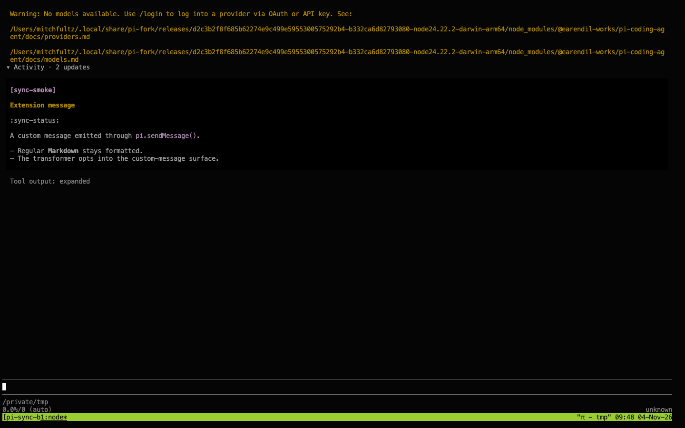
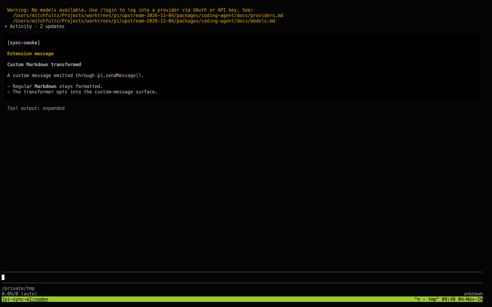

# Upstream integration: 2026-11-04

## Baseline

The fork integrates upstream `d6339fb09739851e4165a38e45bd97a0348ea727` from
`earendil-works/pi` main. At the initial fetch, fork main
`d2c3b2f8f685b62274e9c499e5955300575292b4` was 134 commits behind and 885 ahead.
Two more upstream commits arrived during verification, bringing the total to 136.
They add Chord reload fixes and p2's terminal side panel and merge without conflicts.
The histories diverged from `3e0eec29f50e7861e9db91f2d12723267411b4f3`.
The merge preserves both histories, without rebasing or force-pushing.

## Conflict decisions

The merge had 43 conflicted paths. Unreleased changelog sections combine both branches;
released sections remain unchanged. The other decisions are below.

| Area | Resolution and reason |
| --- | --- |
| Chord | Adopt upstream v2 at the root and remove the unused v1 host and transport remnants. Keep the fork's `CheckJsonOptions` container hook in `/json`. Native working-session validation and streaming-file helpers import `/json`; Durable uses `/context`, `/delta`, `/json` and the v2 store. |
| MCP | Use upstream's shared chunked JSON-RPC line reader and byte-bounded HTTP error reader. Keep the fork's SSE fragment accumulation, combined with upstream CR, LF and split-CRLF handling and reader cancellation. |
| Anthropic | Adopt message threads and native retry handling. Keep payload-pass and attempt tracing, upload compression and request-wide strict-tool budgets. Cache warming disables continuation and retains prepared-auth timing. |
| Output budgets | Use upstream's proportional safety margin with the fork's target-model-aware context estimate. |
| Session operations | Keep complete working-session admission, background cancellation and deferred tool selection. Add upstream prompt-preflight navigation and reload guards. |
| Runtime quit | Keep nonblocking ordinary quit. Strict shutdown waits for tool settlement before disconnecting persistence. Upstream's unconditional wait hangs the fork's unresponsive-tool and shutdown-hook regressions. Ordinary quit can still leave an interrupted tool call without its final result. The #9124 regression runs on the strict path. |
| UI | Keep compact activity, custom-message images and draft capture at mount. Add upstream custom-message Markdown transformers and expanded draft text. Existing constructor arguments retain their positions. |
| RPC | Combine working-session read-only and mutation admission with upstream command counting and shutdown-response ordering. |
| Auth and shell | Use upstream's canonical credential lock shape while retaining atomic writes. Keep complete private Bash spill finalization and upstream discarded-output truncation reporting. |
| Grep | Use ripgrep's context output, eliminating matched-file rereads. Retire the old reread-hook test; upstream tests exercise overlap, CRLF and UTF-16 through real files. |
| Build and dependencies | Keep case-safe batched builds, batched Nix packing and isolated tests. Include the tutorial workspace and p2 dependencies. Root tests select package workspaces; p2 has separate checks. Regenerate the installer lock for Chord's optional React peer. No new install-script allowlist entries are needed. |

## Active consumers

Inspection covered enabled user packages and local extensions, including their built output.
No active extension imports Chord. `pi-change-working-dir` uses the default
`createGrepToolDefinition(ctx.cwd)`, not the removed reread hook. `pi-agent-browser-native`
uses shutdown `disposition` to distinguish restart from exit; that contract remains intact.
Posthorse's custom-message callers use the first four constructor arguments, which are unchanged.
The native MCP builtin remains disabled in the owner's configuration; `pi-mcp-adapter` is active.
No extension configuration is changed by this integration.

## Verification

- `npm run build`: passed, including fresh model generation and the bundled CLI.
- `npm run check`: passed, including lint, types, dependency declarations, entry graphs,
  installer-lock validation and browser smoke.
- `npm --prefix apps/p2 run check`: passed.
- Focused MCP suites: 38 tests passed. Focused AI suites: 201 tests passed.
- Focused coding-agent suites: 195 tests passed before the quit conflict was resolved;
  the two affected runtime suites then passed all 25 tests with the final resolution.
- `./test.sh`: passed in an isolated Linux container for the initial integration. Later
  runs exposed a watcher-test race: the file write's native event can arrive during discovery,
  which correctly preserves its newer mark. The test now waits for discovery to catch up
  before asserting that the mark cleared. Production code and real-event tests are unchanged.
- Chord's new reload suite with Chromium: eight suites passed, with 28 passing tests and
  two upstream expected failures.
- Separate p2 suite: 644 passed, four failed, one skipped, plus an `ENOTEMPTY` cleanup-hook
  failure. All three browser timeouts passed on rerun. The MCP placement assertion at
  `apps/p2/test/p2/mcp.test.ts:587` and sheet cleanup failure reproduce on untouched upstream
  `fcebc0995` with its own dependencies. The reply timeout also reproduced there. No tests
  were weakened or disabled. The 15 p2 TUI P11 tests, including the new side panel, passed.
- Real terminal inspection verified custom-message Markdown transformers alongside the
  retained compact view. Before and after screenshots are included below.

The Linux run uses Node 26.9.0, the native Env daemon, Chromium and fd 10.5.1. Initial
macOS attempts exposed upstream Chord path and platform assumptions. Linux verification
avoids changing upstream tests to fit this host. Missing Linux Go and an older fd binary
were corrected in the disposable test container, without product changes.

## UI evidence

The same isolated slash command emits a custom message before and after integration.
The compact view remains available; the expanded message now applies its Markdown transformer.
These captures use no provider calls or user session data.

| Before | After |
| --- | --- |
|  |  |

The local evidence directory is `/tmp/pi-upstream-sync-2026-11-04/`. It contains the
conflict list, decision log, dependency diff and active-consumer references. Background-command
logs are retained in the owning Pi session. These offline checks do not claim live-provider
or all-device qualification.
