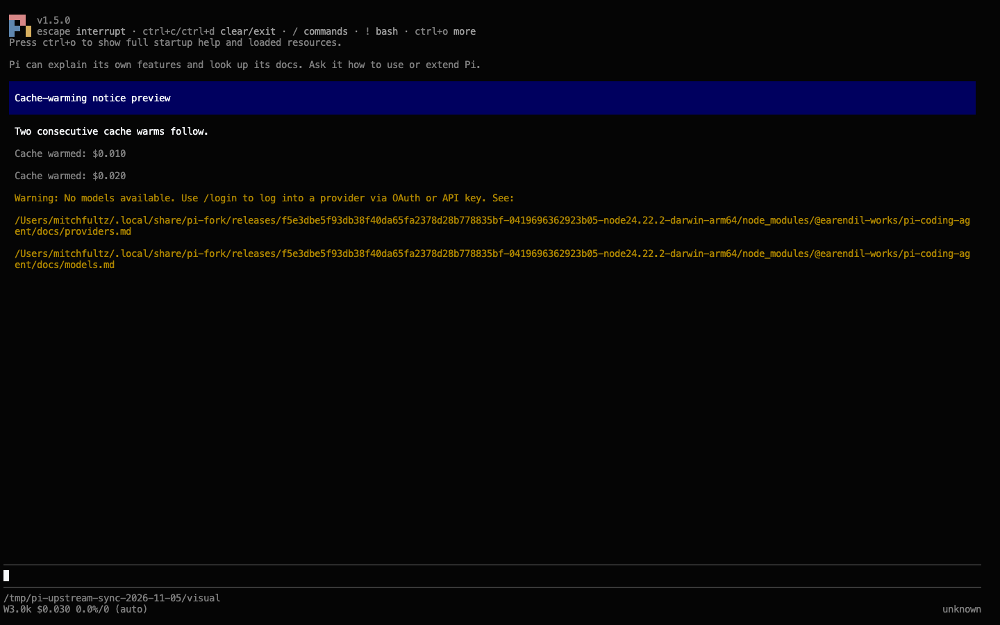
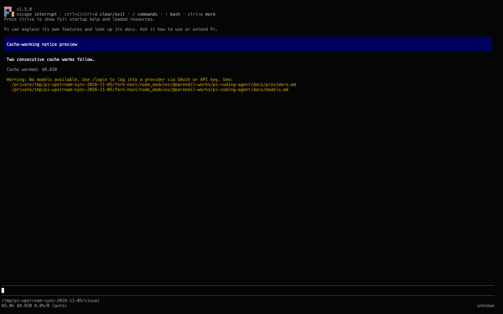

# Upstream integration: 2026-11-05

## Baseline

The fork integrates upstream `80d4d3c869016ed9c61d16a88e5eb5e0e56186a9` from
`earendil-works/pi` main into fork main `f5e3dbe5f93db38f40da65fa2378d28b778835bf`,
bringing in 60 upstream commits. The merge base is the previous integration's
upstream commit, `4d72d05bcd1ea9d26f36f6567be10d00ae6bb5f7`.
Three merges preserve both histories, without rebasing or force-pushing. The first integrates
56 commits through `d9af3d73a`. The second adds two commits published during verification:
a README link correction and the OpenAI Codex provider display-name correction.
The third adds upstream's overlay blocked-status and reload cleanup fixes through `80d4d3c86`.

## Conflict decisions

The first merge had 11 conflicted paths. The second conflicted only in the AI changelog.
The third conflicted in interactive mode and its status test, for 13 distinct paths overall.
All changelog resolutions combine unreleased entries without changing released sections.

| Conflicted path | Resolution |
| --- | --- |
| `.github/workflows/ci.yml` | Keep fork CI without upstream's release-tag publishing trigger. |
| `.github/workflows/preview-packages.yml` | Keep the fork's deletion of upstream publishing automation. |
| `packages/coding-agent/CHANGELOG.md` | Combine both unreleased sections. |
| `packages/coding-agent/src/core/agent-session-runtime.ts` | Add upstream's credential-write wait after disposal. Preserve the working-session gate, strict finalization, shutdown disposition, and nonblocking ordinary quit. |
| `packages/coding-agent/src/core/compaction/utils.ts` | Keep `NestedToolCalls` and add upstream's `sliceHead`. |
| `packages/coding-agent/src/core/tools/read.ts` | Adopt upstream text streaming. Preserve whole-document JSON selection, selection-specific paging, and image refusal. |
| `packages/coding-agent/src/extensions/mcp/index.ts` | Keep `WorkingSessionSaveEvent` and add upstream's `sliceHead`. |
| `packages/coding-agent/src/modes/interactive/interactive-mode.ts` | Keep `ManagedRestart`, add upstream's `addMcpServerConfig`, and adopt cumulative cache-warm notices through compact-view activity grouping. In the third merge, use upstream's overlay tracking, blocked status, and reset cleanup. Retain the fork's working-session admission, late-component disposal after early completion, and draft capture at mount. |
| `packages/durable/CHANGELOG.md` | Combine both unreleased sections. |
| `packages/durable/src/storage/sqlite/storage.ts` | Adopt upstream batched statements. Preserve admission checks through the same writes with confirmed rollback, refusing only `SQLITE_TOOBIG`. |
| `packages/schema/CHANGELOG.md` | Combine both unreleased sections. |
| `packages/ai/CHANGELOG.md` | Add the upstream provider rename under the existing unreleased Changed heading. |
| `packages/coding-agent/test/interactive-mode-status.test.ts` | Keep both sets of behavioral tests. Run upstream's overlay-reset case through the fork's existing typed fixture with native working-session admission and overlay state. |

The fork also excludes upstream's new `p2-cloud-bundle.yml`, which uploads to upstream's
R2 bucket. The local cloud-bundle script remains available.

Supporting adaptations:

- `packages/coding-agent/test/auth-login.test.ts`: the Ctrl+C stub intercepts only network
  catalog refreshes. The fork's local credential synchronization still runs normally.
- `packages/coding-agent/docs/extensions.md`: the streaming-read note states that JSON selections
  read the whole file.
- `scripts/performance/fixtures/durable-storage.ts`: uses batched `Storage.commit` and asserts
  that every write is stored. Its counting adapter implements the current SQLite executor,
  including `runCounted`.
- `packages/durable/src/storage/sqlite/commit.ts` and its native SQLite test preserve the
  fork's suppression of redundant stored record-ID claims on upstream's batched path.
  The new test fails without the filter and passes with it.

## Performance

SQL counts come from `scripts/performance/run.mjs --groups sqlite-1,sqlite-1024`, 30 writes each.
The fork main column runs the same fixture against fork main's sources.

| Workload | Fork main | Merge |
| --- | --- | --- |
| Document deltas: SQL calls | 150 | 150 |
| Document deltas: string-binding bytes | 771 | 1,543 |
| No-op writes: SQL calls and WAL bytes | 0 | 0 |
| Task checkpoint replacements: SQL calls | 120 | 120 |

WAL growth is identical at 1 KiB and 1 MiB payloads. Without the claim filter, the task
replacements took 150 calls: one `record_ids` insert per update of an existing task. Upstream
binds ID lists and rows as JSON arrays, which adds the binding bytes; the statements are the same.

The tools fixture timed reads on both trees: 32 MiB of text and 8 MiB of JSON, two alternating
passes of seven runs on a shared workstation. The medians are indicative, not a qualified
benchmark. Outputs were byte-identical.

| Read | Fork main (ms) | Merge (ms) |
| --- | --- | --- |
| File head | 16.8-17.0 | 16.7-17.5 |
| Middle page | 15.2-16.3 | 16.0 |
| 10 lines from the start | 9.0-9.3 | 12.6 |
| JSON selection | 5.9-6.1 | 6.0-6.1 |

Fork main buffered the whole 32 MiB file on every text read; the merge's heap and buffer growth
stayed under 13 MiB.

## Verification

- `npm ci --ignore-scripts`, `npm run build` and `npm run check`: passed. The installer lock
  needed no regeneration.
- Focused coding-agent suites for read, truncation, cache warming, credentials, auth, MCP, Radius,
  Bash spill, compact view, restart, working sessions, the model runtime and runtime exit:
  42 files, 731 tests passed.
- Durable: 15 files, 429 tests passed; with `PI_DURABLE_DOCUMENT_RETENTION_MS=0`, 8 files,
  285 tests; the Workers suite, 4 files, 51 tests.
- Schema: 8,746 passed, 9 expected failures, 2 skipped. AI validation: 181 tests passed.
- Full `./test.sh`: passed on Linux arm64 at `e8e86ee1c`, using Node 26.13.0, the native
  Env daemon, Go 1.27.3 and fd 10.5.1. Its credential-gated and platform-gated skips remain.
  The initial macOS run hit 13 upstream Chord path/watcher assumptions and one example
  timing failure. The example passed all 18 tests on rerun. As in the previous integration,
  Linux supplies full-suite proof without platform-specific rewrites of upstream tests.
- Final overlay integration: six native UI and working-session files, 155 tests passed.
  Root `npm run check`, its browser smoke, and p2's type/lint check passed.
- All 26 maintained code packages and the embedded device-export extension loaded on the
  synced fork and vanilla upstream `80d4d3c86`. Native SDK/CLI exercises, installed-set co-loading,
  real headless Chrome operations, read-only macOS accessibility, and local transport probes passed.
  Official stable 1.5.0 was independently exercised too. Model-evaluation trials require the
  fork's complete working-session IPC; vanilla supports loading and the other commands, not trials.
  The fork's full native trial suite passed all 18 cases.
- Retired-history archive CLI: 18 tests passed in a separate privileged Linux test container.
  Those checks could not run on the Mac without sudo. No host privilege settings were changed.
- Compatibility required two test-only repairs in external extension repositories: the native
  session-header rename and exclusive execution of tests that temporarily modify shared lint
  configuration. No extension runtime changes were needed.
- p2's complete suite is still running; remote CI is pending. The private per-package record names
  exact revisions, exercised behavior, reruns and external-service limits.

## UI evidence

A seeded journal shows two consecutive cache-warm usage entries. The initial fork renders
two notices; the integrated code renders one cumulative notice. These are real TUI captures
without provider calls or a billing claim. The later overlay integration leaves this code unchanged.

| Before | After |
| --- | --- |
|  |  |

The local evidence directory is `/tmp/pi-upstream-sync-2026-11-05/`. It contains the logs and
performance output. These offline checks do not claim live-provider or all-device qualification.
