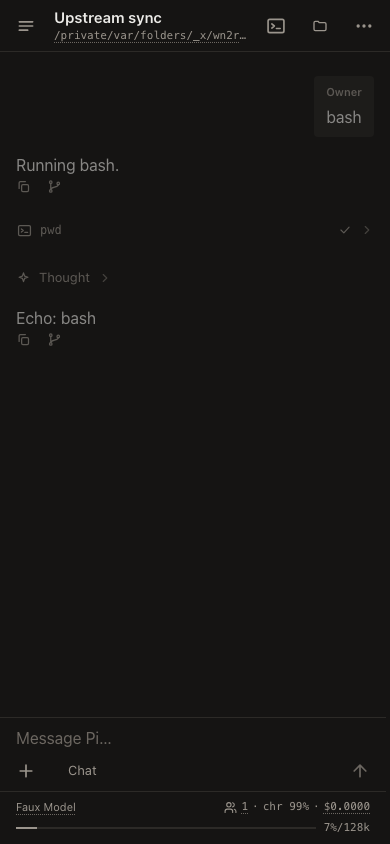
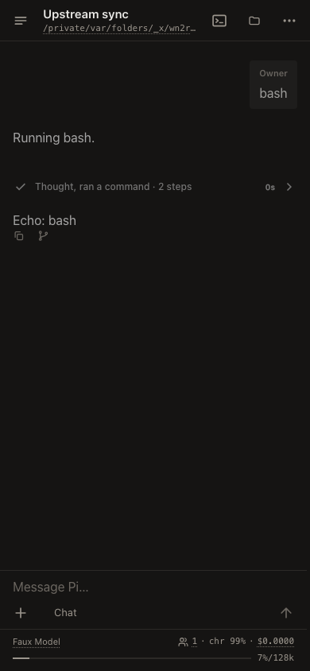

# Upstream integration: 2026-11-07

## Baseline

This integration merges upstream main `085c84e98e7f4c950f2be606466fff4f75d8fe7c`
into fork `5b0ba6bb6c0e6aaeedd40ef7d072e58f279ef500`, preserving both histories.
The common upstream baseline is `80d4d3c869016ed9c61d16a88e5eb5e0e56186a9`.
There are 53 incoming non-merge commits, mostly p2's activity UI, native sandbox and per-host
file-store work. The latest official release remains v1.5.0.

## Conflict decisions

Nine paths conflicted. Changelog resolutions combine unreleased entries and leave
released sections unchanged.

| Path | Resolution |
| --- | --- |
| `packages/{codemode,coding-agent,durable,env,mcp}/CHANGELOG.md` | Keep both sets of unreleased entries under their existing headings. |
| `packages/coding-agent/src/core/tools/edit-diff.ts` | Keep the filesystem-preview adapter. Move upstream's line-ending splicing and bounded diff-window computation into the fork's existing shared Durable owner, then re-export the helpers used by callers. |
| `packages/coding-agent/src/core/tools/edit.ts` | Use the shared owner, retain strict UTF-8 decoding, and adopt upstream's diff-before-write and original-line-ending splicing. |
| `packages/coding-agent/src/modes/interactive/interactive-mode.ts` | Keep compact Bash rendering and existing expansion state. Adopt upstream's pending-Bash reset and settlement flush. |
| `packages/tui/test/tui-alt-screen.test.ts` | Keep the fork's cached-image resize regression and upstream's all-terminal covered-row image tests. |

The shared edit matcher keeps the fork's exact mapping back to original Unicode
boundaries rather than upstream's whole-line fuzzy normalization. Both coding-agent
and Durable now use the same line-ending splicing and compute display diffs before
writing. Invalid UTF-8 and ambiguous normalization boundaries still fail without
writing. The upstream diff-before-write test targets the shared implementation it
now calls, rather than mocking the removed local implementation.

Automatic merges retain the fork's working-session admission and persistence,
provider credential isolation, strict-schema budgets, passive tracing, detached
commands, instruction groups and source-aware fullscreen selection. No upstream
publishing or account-management workflow is enabled.

## Verification

- macOS Node 24.22.2: dependency installation, fresh catalog hydration, workspace
  build, full root lint/type/import/entry-graph/install-lock checks and browser
  bundling smoke passed. The installer lock remains current.
- Focused coding-agent checks: six files, 203 tests passed, including native edits,
  UTF-8 safety, bounded diff windows, diff-before-write, pending Bash UI and codemode.
- Fullscreen TUI: 73 tests passed, including both cached-image resize and the new
  all-terminal image ordering cases.
- Full offline Linux suite: pending.
- p2 type/lint check passed. Separate Node 26.9.0/headless Chrome suite: pending.
- The first macOS full run exposed the same Chord symlinked-temp-path assumptions
  seen in the preceding integration, plus a Linux-only `/proc/self/fd` assertion.
  Linux supplies the full-suite check; upstream tests are not weakened or skipped.
  The one coding-agent failure was its mock pointing at the former edit owner;
  retargeting it to the shared owner passes the original assertion.
- Skill-package consumers discovered all 15 packed skills through the candidate
  fork SDK and bundled CLI; all 16 discovery and scripted-session tests passed.
  The skill package's full 85-test suite, discovery smoke and pack check also
  passed on official 1.5.0. These are offline contract checks, not model-quality
  or live-provider claims.
- CI, review and installation: pending.

## UI evidence

The same isolated p2 session runs the faux provider's Bash turn in headless Chrome
at 390 by 844 pixels. The updated default groups the command and thinking behind
one activity row while keeping the answer in the transcript. No user conversation,
credential or provider request is used.

| Before | After |
| --- | --- |
|  |  |

The local evidence directory is `/tmp/pi-sync-2026-11-07/`, including the merge
patches, candidate tree identity, screenshot scripts and append-only decision log.
Background-command receipts retain the complete build and test logs.
