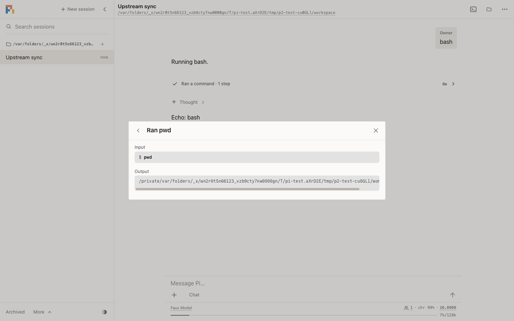
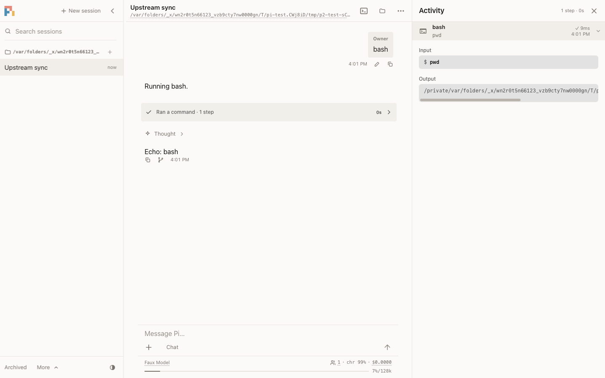
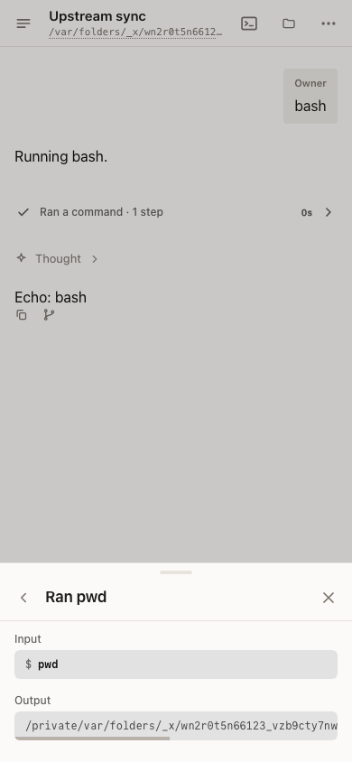
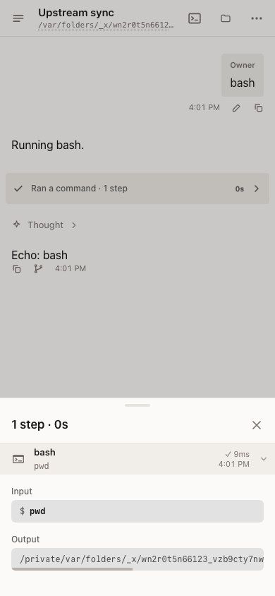

# Upstream integration: 2026-11-09

## Baseline

This integration merges upstream main `bd0d815c3197e75323f6db60ee3ad1f73d5280d7`
into fork `c31bac52cac26cd6fbd2648a1d38079b7bb646b2`, preserving both histories.
The preceding upstream baseline is `085c84e98e7f4c950f2be606466fff4f75d8fe7c`.
There are 80 incoming non-merge commits. The latest official release remains v1.5.0.

The incoming changes include p2's Discord integration, environment secrets, session locks,
local-owner sign-in, activity panels, resizable sidebars, and cache warming. Chord adds
content-based base-input tracking, early app startup, lazy worker-base builds, and plugin
stylesheet reloads. Other packages gain JSONL read-only storage, scheduler admission fixes,
strict-tool limits, provider branding, and codemode and editor fixes.

## Conflict decisions

Twelve paths conflicted. The resolutions retain approved fork behavior and use upstream's
shared implementations where they cover it.

| Paths | Resolution |
| --- | --- |
| `apps/p2/src/hosts/server.ts` | Adopt local-owner sign-in and the startup token. Keep cleanup when plugin loading fails and when a signal arrives during startup. |
| `apps/p2/test/p2/{ui-parity,ui-sheets,voice-ui}.test.ts` | Use authenticated local-owner fixtures and retain the voice test's microphone permission setup. |
| `packages/ai/src/api/anthropic-messages.ts` | Adopt upstream's shared strict-tool limits. Retain request-wide schema budgets, session fallback behavior, and passive cache tracing. |
| `packages/chord/src/node/plugins/watcher.ts` and its test | Adopt content hashes and ancestor-watch renewal. Keep close final for both tree and individual-directory watches. |
| `packages/chord/test/node/workers/workers.test.ts` | Keep early-start, lazy-build, and close-order cases together with the fork's ready-crossing-stop regression. |
| `packages/coding-agent/src/core/cache-warmer.ts` | Use pi-ai's shared timing, replay, request-options, and economics helpers. Keep prepared native retention, refresh deadlines, cycle ownership, and usage attribution. |
| `packages/coding-agent/docs/settings.md` | Document the upstream `idle` default and the retained economics and timing behavior. |
| `packages/coding-agent/src/modes/interactive/interactive-mode.ts` | Adopt provider branding and animation disposal without removing native working-session admission or the fork's transcript behavior. |
| `packages/durable/README.md` | Keep input-admission documentation and adopt JSONL read-only storage documentation. |

Cache-warming policy has one owner, `packages/ai/src/cache-warming.ts`. Both coding-agent
and p2 use it. The shared policy retains effective native retention, one-hour write prices,
prompt-length pricing tiers, and warming trace attribution. Coding-agent still schedules from
the prepared request without replacing its replay options. Estimates remain catalog estimates,
not claims about provider-wrapper or service-tier prices.

p2 observes prepared cache retention through pi-ai's optional `Models.streamSimple()` callback,
after native auth and header preparation. The Harness retains only retention, lifetime, and
dispatch time; replay options remain unresolved. This fixes a reproduced five-minute request
being scheduled as a one-hour request when stored credential environment values differ from
the process environment.

Each p2 refresh rechecks entry expiry after the host's phase decision and after auth preparation.
Timers run from dispatch, not response completion. Both coding-agent and p2 keep the shorter of
the old and newly requested lifetimes across refreshes. Anthropic documents that reading a five-minute entry
[restarts its five-minute lifetime even when the new request asks for one hour](https://platform.claude.com/docs/en/build-with-claude/prompt-caching#mixing-different-ttls).
A failed p2 refresh reuses its retry delay only when the retry can start before expiry.
Otherwise it stops and releases the worker's keep-alive.

The default is upstream's `idle`: warming may continue after the run settles, within the
existing 30-minute idle window and savings threshold. An explicit `off` or `streaming`
setting remains authoritative. No user settings file is changed by this integration.

The existing OAuth selector keeps native working-session admission and disposes the new
brand animation when the selector closes. The prompt-cache suite imports the shared public
TTL helper rather than the retired coding-agent-local export.

## Test isolation

An isolated home and browser profile do not isolate macOS's keychain. The Chord browser
launcher now uses Chrome's `--use-mock-keychain` on macOS, as the fork's three p2 launchers
already do. This addresses the Chrome keychain dialog reported during verification without
changing the user's keychain. Chromium documents this switch as preventing blocking test
dialogs in its [OS crypt switches](https://chromium.googlesource.com/chromium/src/+/8fdb6114e53446376e1f5a8d3a841cc6ea16b928/components/os_crypt/os_crypt_switches.h).

Chord's browser also starts with an emulated light color scheme. Its stylesheet tests require
black unstyled text; inheriting the host's dark theme made three assertions fail with white
text. Theme tests still explicitly switch between dark and light. All nine stylesheet tests
and all three page tests pass with these isolated settings in real Chrome on macOS.

## Shell timeout fixture

The Mac CI shell-timeout fixture returned the shell's exit code 3 after 0.4 seconds,
before its one-second deadline. The case requires continuous background output.
It now uses one Node interval writer instead of spawning a sleep process for each tick.
The timeout and exit-code assertions are unchanged. Production shell helpers are unchanged.

## Verification

- macOS Node 24.22.2: clean dependency installation, fresh catalog hydration, workspace build,
  root lint and type checks, import and entry-graph checks, installer-lock verification,
  and browser-bundling smoke passed. The p2 lint and type check also passed.
- Focused package tests passed: 92 AI tests, 113 coding-agent tests, 200 editor tests,
  159 codemode sandbox tests, and 167 Durable storage and harness tests.
- After the prepared-request and retry fixes, the affected AI tests passed all 61 cases,
  coding-agent passed 131, and p2 passed 13. Root and p2 checks and normal commit hooks passed.
  The regressions failed before their fixes.
- A real p2 worker, file credentials, and the native Anthropic SDK sent a five-minute request
  to a loopback HTTP server. The retained timing matched the wire request, without retaining
  prepared credentials or resolving the stored replay options.
- Real macOS Chrome: all 12 Chord page and stylesheet tests passed, including reloads,
  failed and slow stylesheet loads, reconnection, theme changes, and click tracing.
- The first p2 diagnostic run passed 89 tests, failed three gesture and haptic assertions,
  and skipped 11 native-terminal cases. All three failures also reproduced on the
  untouched upstream source. This diagnostic run is not a full p2 pass.
- A separate Node 26 run passed 34 p2 tests, including TUI create/send, reconnect,
  admission, failed-worker replacement, editor handoff, session operations, sandbox
  secret handling, and sheet parity. One bundle-reload test timed out in that run;
  it passed alone on both the candidate and untouched upstream. Three remote-environment
  cases retained their native skips.
- Linux Node 26.13.0 and real Chromium: 113 p2 tests passed, with two Gondolin sandbox
  skips and no failures. This includes native terminal reconnects, server-start cleanup,
  TUI worker replacement, owner and foreign-request authentication, Discord's faux-provider
  flow, cache warming, activity panels, and mobile interactions.
- macOS managed restart, background-command, Bash cancellation, and timeout checks passed
  all 106 tests. The Linux TUI package suite also passed as an unprivileged user.
- The broad Linux package sweep completed. All package groups except coding-agent passed,
  including Durable's normal, zero-retention, Store, and Workers runs. Coding-agent
  passed 3,830 tests and failed three permission assertions while running as root.
  Both affected test files then passed all 139 tests as an unprivileged user, with no
  source changes. The initial sweep exited with status 1, not a full-suite pass.

Hosted GitHub Actions initially rejected dispatches because workflows on the fork were paused,
despite the repository's enabled setting. The owner re-enabled them.
[CI run 42669038391](https://github.com/fitchmultz/pi/actions/runs/42669038391)
passed all six jobs on source commit `69db50cef133131dfc327737ecb47915ff4f8614`.
This includes the build, package suites, standalone CLI, public consumers, and MCP conformance.
The Mac job passed all 106 restart, background-command, cancellation, and timeout tests,
plus all four workspace-build and release-liveness tests.
[Nix run 42669038283](https://github.com/fitchmultz/pi/actions/runs/42669038283)
passed builds for Linux x64, Linux arm64, and macOS arm64.

Independent Cursor and Pi Durable source reviews found no actionable findings after the fixes.
The automated Pi Durable check on that source commit ended incomplete without posting findings.
The completed independent Pi Durable review does not claim an automated check pass.

## UI evidence

The same faux-provider Bash turn runs in isolated p2 instances before and after the merge,
with an explicit light color scheme. At 1440 by 900 pixels, activity changes from a centered
modal to a docked panel beside the chat. At 390 by 844 pixels, it remains a sheet and expands
the command inline instead of opening another page inside the sheet.

| Before | After |
| --- | --- |
|  |  |
|  |  |

The evidence directory is `/tmp/pi-sync-2026-11-09/`. Background-command receipts retain
complete build and test logs. These offline and faux-provider checks do not qualify live
provider behavior, Discord delivery, remote sandboxes, Windows, or a physical Termux device.
